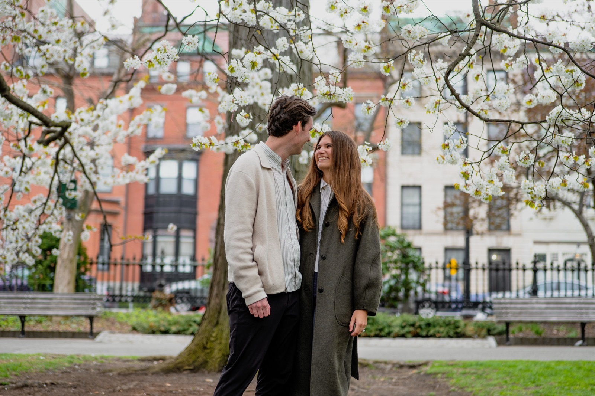

# Josh & Laura — Save the Date

**August 21, 2027 · 5 PM · Old Lyme, CT**

A single-page, animated save-the-date invitation styled as a tactile paper-collage poster, followed by a "We hope you can join us" countdown section. Plain static HTML/CSS/JS, no build step, no framework — deploys straight to GitHub Pages.

---

## Running locally

Open `index.html` via a local server — loading it directly from the filesystem (`file://`) can cause local font-loading issues in some browsers.

```bash
python3 -m http.server 8000
# then open http://localhost:8000
```

There is no build step; the files in the repo root are the production output.

---

## Where to edit content

All visible copy lives directly in `index.html` — there's no config file or template for the poster itself. Edit the text nodes in place:

- Headline lines (`SAVE` / `THE` / `DATE`) — the three `.headline-line` spans.
- Names — the two `.name-line` spans ("Josh" / "& Laura").
- Date/time — the `.td-group` block, plus the screen-reader-only `<time datetime="2027-08-21">` element right after it. Keep both in sync if the date or time ever changes.
- Location — the `.location-line` paragraph (currently abbreviated "Old Lyme, CT" to fit the space; the full "Old Lyme, Connecticut" is in the same sr-only `<time>` paragraph above).
- `<title>` and the `<meta name="description">` / Open Graph / Twitter tags at the top of `<head>`.
- The "We hope you can join us" section below the poster (`<section class="join-section">`) — heading, countdown, body copy, and the address button are all plain text/markup there.

## Where to replace the photo

Swap the `src` on the single `` element in `index.html` (inside `.photo-aperture`):

```html

```

Notes:
- The image is shown with `object-fit: cover` inside a fixed portrait aperture; adjust the inline `object-position` style on the same tag to change the crop focus (currently `50% 32%`, weighted toward the top since the source photo is landscape and the couple's faces sit in the upper portion).
- A `grayscale(100%) contrast(1.05)` filter is applied in `styles.css` (`.photo-img`), so a full-color photo will automatically render in the poster's monochrome style — no layout changes needed.
- The `onerror` handler on the tag falls back to `assets/photo-placeholder.svg` automatically if the photo fails to load, so the poster never shows a broken-image icon.
- `assets/photo-1.jpg` and `assets/photo-2.jpg` are real photos left over from an earlier design iteration; they are no longer referenced anywhere and can be deleted or reused as you like.

## Where animation timings live

The entrance sequence is driven entirely by CSS (`styles.css`, "Entrance animation" section) — each animated element has a `[data-anim="..."]` attribute, and its reveal timing is set via `transition-delay`/`transition-duration` on `.poster.is-playing [data-anim="..."]`. The continuous "breathing" zoom that starts once the entrance settles lives in the `@keyframes breathe` / `.poster.breathe` rules right after it. `script.js` only toggles the `.is-playing` and `.breathe` classes once on load — it contains no timing values of its own for the poster animation. There's no replay control; the entrance plays once per page load.

To change timing, edit the `transition` lines in that CSS section (and `ENTRANCE_TOTAL_MS` in `script.js` if the total entrance duration changes, so breathing still starts at the right moment). To change the poster's layout/positions, edit the `cqw`/`cqh` values in the per-layer rules (`.photo-frame`, `.headline`, `.names-strip`, `.timedate`, `.location-line`) — they're derived from a 360×640 reference grid documented in a comment at the top of the file.

## Where the countdown and address link live

Both are driven from `script.js`, in the second IIFE at the bottom of the file (separate from the entrance-animation controller):

- **`WEDDING_DATE`** — a single `Date` constant with a UTC offset (`2027-08-21T17:00:00-04:00`), so every visitor's countdown reaches zero at the same real moment regardless of their timezone. This is independent of the poster's "5 PM", which stays literal display text per the design brief.
- **Address form** — an on-page form (`#address-form` in `index.html`) that posts straight to the Google Form's `formResponse` endpoint, so responses land in the same Google Form/Sheet and nothing is stored by the site. The mapping from page fields to the Google Form's `entry.*` IDs is `GOOGLE_FIELDS` in `script.js` ("Address form" section); the street/unit/city/state/ZIP/country fields are combined into the form's single Mailing Address answer. If a Google Form question is deleted and re-created its entry ID changes and must be updated there. Without JavaScript, a plain link to `https://forms.gle/V6bKL78ozwmJopm16` shows instead.

---

## Link previews (texting/sharing the URL)

When the link is pasted into iMessage, SMS, Slack, etc., the preview card comes from the Open Graph tags in `index.html`'s `<head>` (`og:title`, `og:description`, `og:image`, `og:url`) plus the matching `twitter:*` tags. `og-image.jpg` is a real 1200×630 image generated from the site's own photo and fonts — if the couple photo or names ever change, regenerate it to match (any 1200×630 image works; exact proportions matter more than the method). `tools/og-image-template.html` is the editable source for that image (not part of the live site) — it has the exact regeneration command in a comment at the top.

Two things that can make a preview not show up even when the tags are correct:
- **The page has to be live** at the URL being shared — most apps' preview crawlers fetch the real page over the internet, so this won't work against `localhost`.
- **Caching** — once an app has fetched a preview for a URL, it may keep showing the old one for a while even after you update the image. Testing the raw tags lets you skip that: `curl -s https://www.lauraandjosh.com/ | grep 'og:image'`, or paste the URL into [Facebook's Sharing Debugger](https://developers.facebook.com/tools/debug/) / [Twitter's Card Validator](https://cards-dev.twitter.com/validator) to force a re-fetch.

---

## Deployment — GitHub Pages

This repo's existing Pages setup is unchanged:

- `CNAME` (custom domain) and `.nojekyll` are preserved at the repo root.
- All asset paths are **relative** (`assets/...`, not `/assets/...`), so the site works whether it's served from a custom domain root or a GitHub Pages project subdirectory.
- No routing, server, or build step is required — push the updated files and Pages serves them as-is.

---

## File map

```
/
├── index.html                       poster + join-us/countdown section (progressive enhancement: fully readable without JS)
├── styles.css                       design tokens, layout, paper texture, animation
├── script.js                        entrance-animation controller + countdown (no shared state between them)
├── .nojekyll                        prevents GitHub Pages from running Jekyll
├── CNAME                            custom domain
└── assets/
    ├── fonts/
    │   ├── anton-latin.woff2            headline + date/time typeface
    │   ├── montecarlo-latin.woff2        script typeface (names, form heading)
    │   ├── playfair-display-latin-700.woff2  location line + join-section typeface
    │   └── roboto-slab-latin.woff2      date/time + countdown numerals
    ├── couple-photo.jpg              real photo shown in the poster — see above to replace
    ├── paper-texture-photo.jpg       crinkled-paper background photo (tinted ivory via CSS multiply blend)
    ├── paper-grain.svg               fine grain overlay (photo frame + name strip)
    ├── photo-placeholder.svg         fallback shown if couple-photo.jpg fails to load
    ├── favicon.png                   source favicon icon (50×50)
    ├── favicon-32.png, favicon-16.png  favicon sizes generated from favicon.png
    ├── apple-touch-icon.png          180×180 icon for iOS home-screen bookmarks
    ├── og-image.jpg                  1200×630 link-preview image (couple photo + names/date, generated from the site's own assets/fonts)
    └── photo-1.jpg, photo-2.jpg      unused leftovers from an earlier design iteration

tools/
└── og-image-template.html           editable source for og-image.jpg — not part of the live site
```

---

## Notes on fonts

Anton, MonteCarlo, Playfair Display, and Roboto Slab are all licensed under the SIL Open Font License and are vendored locally as `.woff2` files under `assets/fonts/` (downloaded from Google Fonts) — no external font requests at runtime. If a browser can't load one for any reason, `styles.css` falls back to a generic equivalent (`'Arial Narrow', sans-serif` for the condensed faces, `'Brush Script MT', cursive` for the names, `Georgia, serif` for the serif text).

## Notes on the paper texture

`assets/paper-texture-photo.jpg` is a real crinkled-paper photo the project owner supplied directly (not generated). It's shown with `background-size: cover` and tinted toward the site's warm-ivory palette via `background-blend-mode: multiply` against `--poster-base` in `styles.css` — swap the file for a different photo if needed and the tint will apply automatically.
